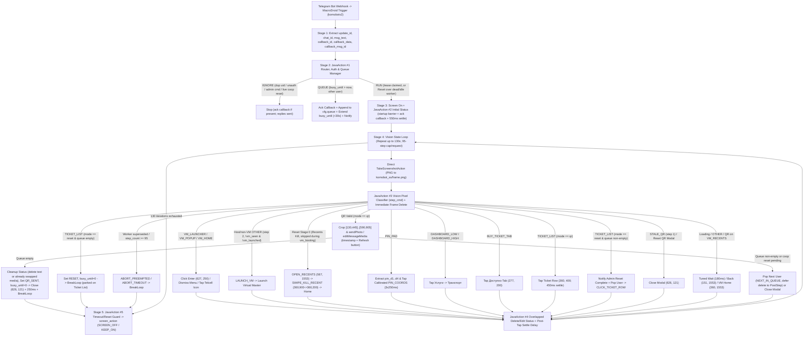

# Komobot — Standalone Android QR Automation Controller

Komobot is a serverless, on-device Android automation pipeline that turns a physical `720x1600` Android phone into a self-contained Telegram QR code responder for **Telcell Wallet** (`ru.deltapay.puntopago.telcell`) running inside **Virtual Master** (`com.clone.android.dual.space`).

Once deployed via ADB, there is **no PC, Docker container, or external backend server** required at runtime: Telegram sends updates directly to a MacroDroid cloud webhook trigger on the phone, and all routing, access control, queueing, host-level screen capture, pixel-based UI navigation, QR cropping, and Telegram photo uploads execute locally inside **MacroDroid**.

---

## Key Capabilities & Architectural Design

* **Standalone On-Device Execution:** Generated via [`generate_macro.py`](generate_macro.py) (`207` MacroDroid actions, `5` BeanShell `JavaAction` scripts) and deployed over ADB with [`deploy_macro.sh`](deploy_macro.sh). All runtime state lives in `/storage/emulated/0/Download/komobot_config.json`.
* **`FLAG_SECURE` Bypass & Zero-Flash Direct PNG Capture:** Financial apps block `adb screencap` and native screenshots when run directly on the host OS. Running the target app inside **Virtual Master** renders the guest OS inside a Virtual Master host surface, letting MacroDroid's host-level `TakeScreenshotAction` (`uiOption: 1`, `screenshotFormat: 1`) capture every screen directly to `/storage/emulated/0/komobot_ss/frame.png` without SystemUI screenshot animations/flashes or MediaStore thumbnail delays.
* **Serverless Telegram Webhook & In-Place One-Tap Refresh:** Telegram Bot API `message` and inline button `callback_query` updates arrive via a MacroDroid `WebHookTrigger` (`identifier: "komobotv2"`, body stored in `{lv=webhook_body}`). Every delivered QR photo includes a local capture timestamp and ~30s validity hint (`"🎫 QR Code • HH:MM:SS (valid ~30s)"`) plus an inline `"🔄 Refresh QR"` button (`callback_data: "/qr"`). Tapping `"🔄 Refresh QR"` refreshes that photo message **in-place** without adding new chat messages: Stage 3 replaces the button with an inline progress bar (`editMessageReplyMarkup`, `callback_data: "noop"`), Stage 4 updates the bar percentage, and completion atomically swaps the photo, caption timestamp, and `"🔄 Refresh QR"` button via `editMessageMedia` (falling back to `sendPhoto` on HTTP `4xx`).
* **Multi-User Access Control, Cooperative Preemption & In-Loop Queueing:** Authorized users share access through `/storage/emulated/0/Download/komobot_config.json`. Concurrent requests are serialized by a time-bounded `busy_until` lease, a single-worker heartbeat (`worker_active` / `worker_heartbeat_ms`), and an in-memory/disk FIFO `queue` so burst requests execute back-to-back in a single phone wake cycle. When a live worker is already in flight, Admin `🧹 Reset VM App` preempts it cooperatively in-place (avoiding colliding Stage 4 loops); queued requests received during a reset pop straight into `CLICK_TICKET_ROW` once Telcell lands on `TICKET_LIST`. Any regular-user timeout or QR upload HTTP failure keeps user replies generic while alerting `admin_id` with diagnostics.
* **Stale Ticket, Stale QR & Direct Warm Foreground Retention:** Navigates through the dashboard **`Услуги` → `Транспорт` → `Доступно`** ticket list rather than quick shortcuts (which can open an expired/stale ticket). Automatically switches tabs if `Купить билет` opens instead of `Доступно`, and rejects/refreshes a QR modal if one was already open on `step_count == 1`. Both `DONE` (after QR modal close at `(626, 121)`) and Option A `DONE_RESET` (after force-closing via VM Recents and cold-relaunching) keep Telcell Wallet foregrounded on `TICKET_LIST` inside Virtual Master's `VMDisplayActivity`, while Stage 3 wakes directly onto the active VM surface (falling back to `LAUNCH_VM` in Stage 4 only if a non-VM host screen is seen) so warm QR requests finish in 2 steps without hitting `VM_LAUNCHER`.
* **Deep Doze & Extended Inactivity Resilience:** [`deploy_macro.sh`](deploy_macro.sh) disables Android Doze (`dumpsys deviceidle disable`), app standby, Android Phantom Process Killer monitoring (`settings_enable_monitor_phantom_procs false` and `max_phantom_processes 2147483647` for Virtual Master's guest processes), Wi-Fi power saving/sleep, host lockscreen, system window/transition/animator animations (`0`), scheduled/light theme switches (locking Dark Mode via `cmd uimode night yes`), Virtual Master toast windows, and Samsung Smart Capture toolbars, plus creates `/storage/emulated/0/komobot_ss/.nomedia`. Extended cold-boot tolerances (`130×` macro loop with a `95`-step per-request cap, `vm_booting` tracking across `VM_LAUNCHER`/`VM_LOADING`, `OTHER <= 30` during cold VM boot, `WHITE_LOADING <= 7` in `qr` / `<= 18` during `vm_booting` or `reset`, `DASH_LOADING < 5`, `QR_LOADING`/`PIN_SPINNER`/`TICKET_LOADING <= 9`) let Virtual Master and Telcell Wallet recover even after full app kills or LMKD evictions, while keeping Virtual Master in the host foreground on sleep (`ScreenOnAction(screen_off=True)`). *(Re-run `./deploy_macro.sh` after a full phone reboot, as `dumpsys deviceidle disable` is non-persistent.)*

---

## Full Pipeline Architecture

The generated macro (**Komobot Controller**, `207` actions) processes every incoming Telegram update through five stages (reusing HTTP/1.1 Keep-Alive TLS connections across Telegram API calls):



### Stage 1: Webhook Ingestion & Field Extraction

Triggered by MacroDroid's `WebHookTrigger` (`identifier: "komobotv2"`), five `TextManipulationAction` (`ExtractTextManipulation`) steps extract values from `{lv=webhook_body}` with safe default suffixes so missing JSON fields never abort the macro:

| Local Variable | Regex Pattern | Fallback Source Suffix |
| :--- | :--- | :--- |
| `update_id` | `"update_id":\s*(\d+)` | `"update_id":0` |
| `chat_id` | `"chat":\s*\{\s*"id":\s*(-?\d+)` | `"chat":{"id":0` |
| `msg_text` | `"text":\s*"([^"]{0,200})"` | `"text":""` |
| `callback_id` | `"callback_query":\s*\{[^}]{0,120}"id":\s*"([^"]{0,80})"` | `"callback_query":{"id":""` |
| `callback_data` | `"data":\s*"([^"]{0,100})"` | `"data":""` |
| `callback_msg_id` | `"message":\s*\{[^}]{0,80}"message_id":\s*(\d+)` | `"message":{"message_id":0` |

### Stage 2: Router, Auth, Command Handler & Queue Manager (`JavaAction #1`)

`build_router_script()` runs synchronously under `synchronized (System.class)` to keep `komobot_config.json` consistent across concurrent webhook invocations:

1. **Deduplication, Callbacks & Diagnostics:** Drops any non-zero `uid <= last_update_id` (`return "IGNORE"`). Updates with `update_id: 0` bypass deduplication and never advance `last_update_id`, making synthetic diagnostics safe. When a `callback_query` arrives (`callback_id` non-empty and `callback_data` non-empty):
   * `"noop"` (tapping the inline progress/queue button while a refresh is active) answers with toast `"⏳ Refresh already in progress..."` and returns `"IGNORE"` without touching chat history.
   * `"/qr"` (inline `"🔄 Refresh QR"`) overrides `msgText` with `callback_data` while ignoring any button `"text"` matched inside `callback_query.message.reply_markup`; when `callback_msg_id > 0`, the run is marked `status_is_media = true` (targeting that existing photo message in-place). Non-`RUN` paths answer the callback directly via `answerCallbackQuery` (with toast alerts for already-active/queued users instead of extra chat messages); `RUN` stores `pending_cb_id` so Stage 3 overlaps `answerCallbackQuery` with the screen-wake settle. Every non-duplicate update records `last_chat_id` and `last_msg_text` in `komobot_config.json`.
2. **Authorization:** Compares `chat_id` against `admin_id` (seeded from `{lv=admin_id}`) and `allowed_users`. Unauthorized users receive `⛔ Unauthorized. Your ID: <cid>`.
3. **Access & Admin Commands:** Handles `/start` (role-specific Reply Keyboard), `/adduser <id>`, `/removeuser <id>`, `/listusers` / `👥 List Users`, and `/toggle` / `🛑 Toggle Public Access`. When `public_access` is `false`, non-admin allowed users receive `⚠️ The bot is currently locked by the admin.`.
4. **Concurrency Lock, Queue Insertion & Admin Reset Preemption:**
   * If `now < busy_until` and the request is not an admin `🧹 Reset VM App` preempting a non-reset run:
     * Same `active_chat_id` (after `>= 3s`): replies `⏳ Your request is already in progress.` (as a `callbackQuery` toast for callbacks, or chat reply for text) without enqueueing a duplicate.
     * Another allowed user not yet in `queue`: appends `{"chat_id": cid, "status_message_id": cbMsgId (or 0), "status_is_media": isMediaRefresh}`, extends `busy_until` by `+30000ms`, either edits the existing photo's inline button (`"⏳ Queued (#N)..."`, `callback_data: "noop"`) or sends a standalone queued status message (detailed waiting notice for Admin; `0%` progress bar for regular users) and patches `status_message_id`.
     * Another user already in `queue`: replies `⏳ You are already in the queue (#N).` (as a `callbackQuery` toast for callbacks, or chat reply for text).
   * If idle (`now >= busy_until`) or admin sends `🧹 Reset VM App` while a non-reset run is active: collects any displaced active/queued chats (`displaced` preserving `status_is_media`), initializes a new run (`busy_until = now + 45000` for `"qr"` or `now + 60000` for `"reset"`, `active_chat_id = cid`, `status_message_id = cbMsgId` when `isMediaRefresh` else `0`, `status_is_media = isMediaRefresh`, `media_init_pending = isMediaRefresh`, `capture_mode = "qr"` or `"reset"`, `queue = []`, `qr_was_closed = false`, `reset_stage = 0`, `reset_kills = 0`, `reset_recents_checked = false`, `reset_open_tries = 0`, `reset_notified = false`, `step_count = 0`, `other_count = 0`, `white_count = 0`, `loading_count = 0`, `vm_seen = false`, `vm_launched = false`, `pending_delete_cid = 0`, `pending_delete_mid = 0`, `progress_pct = 0` or `10`, `pending_status_text = ""`, `last_ss_deleted = true`, `last_state = "INIT"`, monotonic `run_start_ms`, worker coordination fields).
     * When preempting a **live worker** (`worker_active == true` with `worker_heartbeat_ms` `< 20s` old): updates `komobot_config.json` in-place, restores `"❌ Cancelled • 🔄 Retry"` buttons on displaced media refreshes / sends cancel text on displaced text statuses, sends `"🔄 Force-restarting Telcell Wallet..."` directly (`status_message_id`), and returns `bot_action = "IGNORE"` so the active Stage 4 loop picks up the reset cooperatively (`syncActiveConfig`) without spawning a colliding worker.
     * When starting fresh (or over an expired/dead worker): sets `vm_booting = false`, stores `pending_cb_id`, bumps `worker_pending_start_ms` / `worker_start_ms`, deletes any stale `/storage/emulated/0/komobot_ss/frame.{png,jpg}`, and returns `bot_action = "RUN"` immediately without blocking on a Telegram HTTP round-trip.

### Stage 3: Screen Wake & Overlapped Status Init (`JavaAction #2`)

When `{lv=bot_action}` equals `"RUN"`:
1. `ScreenOnAction(screen_off=False)` wakes the display directly onto the already-foregrounded Virtual Master guest window (`VMDisplayActivity`, skipping unconditional `MainActivity` relaunch that would push `VM_LAUNCHER` back on top; lockscreen is disabled at provisioning time by `deploy_macro.sh`).
2. `build_init_status_script()` (`JavaAction #2`) clears `worker_pending_start_ms` and reads/clears `pending_cb_id` + `media_init_pending`: answers any `pending_cb_id` first via `answerCallbackQuery`, then either edits the existing photo's inline button via `editMessageReplyMarkup` (`"⏳ 🟩⬜⬜⬜⬜⬜⬜⬜⬜⬜ 10%"`, `callback_data: "noop"`) when `media_init_pending` is true (preserving the photo even if preempted), or sends a new status message (`🔄 Force-restarting Telcell Wallet...`, `🔍 Waking phone & checking Virtual Master...`, or `10%` progress bar) via HTTP/1.1 Keep-Alive (atomically saving `status_message_id` and deleting orphaned text status messages if superseded mid-flight). Finally notifies any displaced active/queued chats (`❌ Request cancelled by VM reset...` on text statuses or `"❌ Cancelled • 🔄 Retry"` inline button on media refreshes) and enforces a `550ms` settle floor from wake.

### Stage 4: Vision-Guided State Machine Loop (`Repeat 130×`, `JavaAction #3` + `JavaAction #4`)

Each iteration captures a host screenshot (`TakeScreenshotAction` with `uiOption=1`, `screenshotFormat=1`, `customAllFilesPath="/storage/emulated/0/komobot_ss"`, `customFilename="frame"`) and runs `build_vision_script()` (`response_var="step_cmd"`), followed by UI dispatch and `build_post_step_script()`:

1. **Fresh Screenshot Polling, Immediate Cleanup & Overlapped Status (`JavaAction #4`):**
   * Polls `/storage/emulated/0/komobot_ss` (primary zero-flash PNG directory) plus `/storage/emulated/0/DCIM/Screenshots` and `/storage/emulated/0/Pictures/Screenshots` (fallback) for up to `3.8s` (at `40ms` intervals) for a readable file `> 5KB` with `lastModified >= run_start_ms - 2500` and a complete image trailer (PNG `IEND` or JPEG `FF D9`, waiting at `20ms` up to `1.8s` per candidate so truncated writes never decode as dark frames). Using `last_ss_deleted` on private `komobot_ss` frames allows immediate acceptance across same-second FUSE timestamps.
   * Decodes via `BitmapFactory.decodeFile` (up to `6` attempts at `35ms`) and normalizes `(x, y)` coordinates from the `720x1600` reference layout (`px(x) = x * w / 720`, `py(y) = y * h / 1600`).
   * Deletes the consumed screenshot immediately (and cleans fallback `thumbnail_*` / `.trashed-*Virtual Master*` artifacts) with zero post-capture delay, recording `last_ss_deleted`.
   * Instead of blocking before UI taps on Telegram HTTP calls, intermediate step updates are stored in `pending_status_text`; `build_post_step_script()` also drains any deferred `pending_delete_cid`/`pending_delete_mid` from `NEXT_IN_QUEUE` and sends `deleteMessage` / `editMessageText` right *after* the UI tap while sleeping only the remaining post-tap settle delay.

2. **State Classification & UI Dispatch Branches:**

| Detected Screen (`last_state`) | Visual Heuristic (`720x1600`) | Dispatched `step_cmd` & MacroDroid Actions / Settle Window |
| :--- | :--- | :--- |
| Superseded / Timed Out (`worker_start_ms` or `step_count >= 95`) | Newer worker started (`worker_start_ms` bumped) or single-request step cap (`95`) reached | `ABORT_PREEMPTED` or `ABORT_TIMEOUT` -> `BreakFromLoopAction` immediately |
| Cooperative Preemption (`run_start_ms` bumped) | Active loop's `syncActiveConfig` detects newer `run_start_ms` from Admin Reset | Switches active config in-place (`vm_booting` preserved) and continues as `"reset"` cleanly |
| `NO_SCREENSHOT` / `TRUNCATED_SS` / `DECODE_ERR` | No complete screenshot within `3.8s` or unreadable file | `WAIT` -> Pause `50ms` + PostStep (`180ms`, or `500ms` while `vm_booting`) |
| `VM_LAUNCHER` | Dark VM card with bright `Enter` button `(595..670, 235..265)`; sets `vm_booting=true`, `vm_seen=true` | `CLICK_ENTER` -> Click `(627, 250)` + PostStep (`900ms` total) |
| `VM_LOADING` / `SCREEN_WAKING` | Dark VM boot background (`vm_booting=true`, `vm_seen` unchanged) or pure-black `<8` pre-wake frame (`SCREEN_WAKING`, neither flag set) | `WAIT` -> Pause `50ms` + PostStep (`500ms` while `vm_booting`, `180ms` otherwise) |
| `VM_POPUP` | Dark 3×3 Virtual Master quick-menu corners `(130/590, 590/1050)`; sets `vm_seen=true` | `DISMISS_POPUP` -> Click `(100, 200)` + PostStep (`350ms` total) |
| `VM_RECENTS` / `VM_RECENTS_EMPTY` | `#dad9e4` VM Recents backdrop `(40/620, 800)` & `(360, 200/1360)`; clears `vm_booting`, sets `vm_seen=true` | In `"reset"` Stage `0` with card (`reset_kills < 3`): `SWIPE_KILL_RECENT` (`(360, 900) -> (360, 200)` in `200ms`, PostStep `550ms`). Empty/cap or `"qr"` mode: `RESET_TO_HOME` (`(360, 1553)`). |
| `RESET_CHECK_RECENTS` / `RESET_OPEN_RECENTS` | `"reset"` Stage `0` on `VM_HOME` (un-checked), recognized Telcell UI, or non-booting in-app fallback (`!vm_booting`) | `OPEN_RECENTS` -> Click `(567, 1553)` + PostStep (`550ms`), with `WAIT` on retries `2`/`4` and `CLOSE_MODAL`/`CLICK_BACK`/`RESET_TO_HOME` fallbacks |
| `RESET_CLOSE_QR` | QR modal encountered while `capture_mode == "reset"` | `CLOSE_MODAL` -> Click `(626, 121)` + PostStep (`450ms`), never uploads QR |
| `STALE_QR` | QR modal present on `step_count == 1` with `qr_was_closed == false` | `CLOSE_MODAL` -> Click `(626, 121)` + PostStep (`450ms` total) |
| QR Valid -> `NEXT_IN_QUEUE` / `QR_SENT` | Darkened backdrop, white modal card, `>= 100` dark & `>= 100` light QR modules in `(200..520, 510..830)` | Crops `[130, 445]..[590, 905]` (`460x460`), encodes lossless PNG, and delivers `"🎫 QR Code • HH:MM:SS (valid ~30s)"` + `"🔄 Refresh QR"` button (`callback_data: "/qr"`): for `status_is_media == true`, atomically replaces the existing photo, caption, and button via `editMessageMedia` (falling back to `sendPhoto` on HTTP `4xx`, or restoring `"⚠️ Failed • 🔄 Retry"` via `editMessageReplyMarkup` on other errors); for text requests, uploads via `sendPhoto` and deletes/defers `pending_delete_*` on `200`. Alerts `admin_id` on regular-user HTTP errors. |
| `QR_LOADING` | White modal card without QR modules yet | Bounded `WAIT` via `loading_count` (`<= 9` -> `WAIT`; `10` -> `CLICK_BACK`; `11` -> `WAIT`; `>= 12` -> `RESET_TO_HOME`) |
| `VM_HOME_1` / `VM_HOME_2` | Dark VM wallpaper with orange Telcell icon at `(80..120, 360..400)` or `(80..120, 120..165)`; clears `vm_booting`, sets `vm_seen=true` | `LAUNCH_1` `(97, 382)` or `LAUNCH_2` `(97, 142)` + PostStep (`1100ms` total); advances `reset_stage = 2` in `"reset"` mode |
| `PIN_SPINNER` | Gray PIN background with orange Telcell logo and spinner at `(330..390, 680..715)` | Bounded `WAIT` via `loading_count` (`<= 9` -> `WAIT`; `10` -> `CLICK_BACK`; `11` -> `WAIT`; `>= 12` -> `RESET_TO_HOME`) |
| `PIN_PAD` | Gray PIN screen `(100, 500)` & `(360, 1372)` + `>= 10` Telcell orange logo pixels `(280..440, 120..220)`; sets `vm_seen=true` | `ENTER_PIN` -> 4× `ExtractTextManipulation` split `app_pin` into `pin_d1..pin_d4`; `IfConditionAction` branches tap calibrated `PIN_COORDS` (`3×250ms` inter-digit pause, PostStep `850ms` post-PIN settle) |
| `DASH_LOADING` | Dashboard nav visible while white skeleton covers content or `svcLow < 3 && svcHigh < 3` (`loading_count < 5`) | Bounded `WAIT` via `loading_count` (`<= 9` -> `WAIT`; `10` -> `CLICK_BACK`; `11` -> `WAIT`; `>= 12` -> `RESET_TO_HOME`) |
| `DASHBOARD_LOW` / `DASHBOARD_HIGH` | Dashboard bottom nav bar orange/white; scans `Услуги` orange icon offsets (`1045..1105` vs `785..845`) | `CLICK_TRANSPORT_LOW` `(360, 1100)` or `CLICK_TRANSPORT_HIGH` `(360, 840)` + PostStep (`750ms` total) |
| `BUY_TICKET_TAB` | `Проездной билет` opened on `Купить билет` tab (orange underline at `x=100, y=235` or buy card button `(550, 485)`) | `CLICK_AVAILABLE_TAB` -> Click `Доступно` `(277, 200)` + PostStep (`700ms` total) |
| `TICKET_LOADING` | `Доступно` tab active on gray list background, ticket card still loading | Bounded `WAIT` via `loading_count` (`<= 9` -> `WAIT`; `10` -> `CLICK_BACK`; `11` -> `WAIT`; `>= 12` -> `RESET_TO_HOME`) |
| `TICKET_LIST` (`mode == "qr"`) / `RESET` (`mode == "reset"`) | `Проездной билет -> Доступно` (`buyBtnOrange` or `availTabOrange`) with bright white ticket card at `(360, 400)`; sets `vm_seen=true` | `qr`: `CLICK_TICKET_ROW` `(360, 400)` + PostStep (`450ms` total). `reset` (empty queue): `DONE_RESET` -> `BreakFromLoopAction`. `reset` (queue non-empty): notifies Admin reset complete, pops `queue[0]` directly into `"qr"` (`CLICK_TICKET_ROW` + `80%` progress). |
| `WHITE_LOADING` | White/blank transition screen (`>= 34/40` white grid samples in `x=120..600, y=240..1290`, avoiding dense multi-column UI) | Bounded `WAIT` via `white_count` (`<= 7` in `qr`, `<= 18` when `vm_booting` or `"reset"` -> `WAIT`; next -> `CLICK_BACK` `(151, 1553)`; +1 -> `WAIT`; +2 -> `RESET_TO_HOME` `(360, 1553)`) |
| `OTHER` | Unrecognized host or in-app transition/overlay screen (`other_count`) | Host cold fallback (`!vm_booting && !vm_seen && !vm_launched && other_count == 2`): sets `vm_launched=true` and dispatches `LAUNCH_VM` (`com.clone.android.dual.space`, PostStep `900ms`). Otherwise warm/in-app: `<= 2` or `4` -> `WAIT`, `3` -> `CLICK_BACK`, `>= 5` -> `RESET_TO_HOME`. Cold VM boot (`vm_booting`): `<= 30` -> `WAIT`, `31` -> `CLICK_BACK`, `>= 32` -> `RESET_TO_HOME`. |

3. **Clean Exit vs. Queue Handoff & Role-Specific Status UI:**
   * **Admin (`cid == admin_id`):** Receives full internal step-by-step status logs (`🖥️ Entering Virtual Master...`, `🔪 Closing Telcell Wallet...`, `🚀 Launching Telcell Wallet...`, `🔐 Entering PIN...`, etc.) and diagnostic timeout details (`last state: ...`) on standalone text requests; when tapping `"🔄 Refresh QR"` (`status_is_media == true`), intermediate progress uses the compact inline button bar (`"⏳ ...%"`, `callback_data: "noop"`) via `editMessageReplyMarkup` so the original QR remains visible until swapped.
   * **Regular Users (`cid != admin_id`):** Internal step logs are replaced by a monotonic emoji progress bar (`0% -> 10% -> ... -> 80%`, on a text message or inline button) that never regresses backwards and omits internal app/VM details, including on timeouts (`❌ Timed out generating QR code. Please try again.` or `"❌ Timed out • 🔄 Retry"` button).
   * **Queue Non-Empty (`NEXT_IN_QUEUE`):** Pops `queue[0]`, sets `active_chat_id`, `status_message_id`, and `status_is_media` to the queued user, records `pending_delete_cid`/`pending_delete_mid` from the finished request (only when `!status_is_media && HTTP == 200`), sets `step_count = 2`, `qr_was_closed = true`, `busy_until = now + 45000`, queues the inline progress button (if queued item `status_is_media`), `🔄 Generating QR code for your request...` (Admin text), or `70%` progress bar (regular user text) into `pending_status_text`, and returns `CLOSE_MODAL` (`(626, 121)`) so `PostStep` cleans up any completed text status bar and updates the queued user concurrently while returning to `TICKET_LIST`.
   * **Queue Empty (`DONE` / `DONE_RESET`):** On `DONE`, sets `last_state = "QR_SENT"`, `busy_until = 0`, clicks Close `(626, 121)` -> `250ms` -> `BreakFromLoopAction`. On `DONE_RESET`, Option A force-close + reopen breaks directly on loaded `TICKET_LIST` (`last_state = "RESET"`, `busy_until = 0`). Both keep Telcell Wallet foregrounded on `TICKET_LIST` inside Virtual Master's `VMDisplayActivity` so warm repeat QR requests finish directly in 2 steps (`CLICK_TICKET_ROW` -> `QR_SENT`).

### Stage 5: Post-Loop Guard (`JavaAction #5`, `screen_action`) & Conditional Screen Sleep

After exiting the `130×` loop:
* If a newer worker/request claimed the screen (`worker_start_ms > workerStart` or `worker_pending_start_ms > workerStart`), `build_timeout_script()` returns `"KEEP_ON"` immediately without deleting `komobot_ss/frame.*`, mutating config, or editing Telegram messages, and Stage 6 skips `ScreenOnAction(screen_off=True)` so the new run keeps the display awake.
* Otherwise, `build_timeout_script()` deletes any leftover `/storage/emulated/0/komobot_ss/frame.{png,jpg}`, clears `worker_active`/`worker_pending_start_ms`/`worker_exiting_ms`, and checks whether `busy_until > 0` or `step_cmd == "DONE_RESET"` (without `reset_notified`):
  * Resets `busy_until = 0`, `queue = []`, and `pending_status_text = ""`.
  * Edits the active (and any remaining queued) status messages with `✅ VM app reset complete — Telcell restarted & ready.` / `❌ Request cancelled by VM reset. Please try again.` or `❌ Timed out waiting for QR screen (last state: <last_state>). Please try again.` (Admin) / `❌ Timed out generating QR code. Please try again.` (regular user).
  * When a non-reset request times out and affects any regular user (`cid != admin_id`, `cid > 0`, active or queued), sends a diagnostic failure alert to `admin_id` (`chat_id`, reason, `last_state`, `step_count`, and affected queued IDs).
  * Returns `"SCREEN_OFF"`, allowing Stage 6 (`If (screen_action = SCREEN_OFF)`) to execute `ScreenOnAction(screen_off=True)` (`mWakefulness=Dozing`) with Virtual Master still in the host foreground.

---

## Project Structure

```text
komobot/
├── generate_macro.py   # MacroDroid JSON compiler + embedded BeanShell router, vision & guard scripts
├── deploy_macro.sh     # ADB provisioning, Doze/power/lockscreen tuning & automated MacroDroid import
├── tests/              # Offline BeanShell scenario suite + live device webhook runner
│   ├── bsh_runtime.py
│   ├── test_macro_structure.py
│   ├── test_router_and_timeout_scenarios.py
│   ├── test_vision_scenarios.py
│   └── run_device_scenarios.py
├── pyproject.toml      # Project metadata & dev tooling (ruff, shfmt-py)
├── ruff.toml           # Ruff formatting/linting configuration
├── .python-version     # Python version pin (3.10)
├── .gitignore          # Ignores .env, gomorrah/, *.pyc, *.macro
└── .env                # Local secrets & device app config (not committed)
```

Generated artifacts:
* `Komobot_Controller.macro` (ignored by git via `*.macro`): Created by `generate_macro.py` with local variables (`bot_token`, `admin_id`, `app_pin`, `app_name`) populated during deployment and removed from `/storage/emulated/0/Download/` after import.

---

## Setup & Deployment

### Prerequisites

1. **Target Android Phone (`720x1600`, tested on Samsung Galaxy A06 `SM-A065F`):**
   * **USB Debugging** enabled and authorized via `adb devices`.
   * **MacroDroid** (`com.arlosoft.macrodroid`) installed with Accessibility / UI Interaction enabled, plus **MacroDroid Helper** (optional/recommended) and cloud Webhook Trigger active (`https://trigger.macrodroid.com/<device_uuid>/komobotv2`).
   * **Virtual Master** (`com.clone.android.dual.space`) installed with the guest VM configured (`720x1600`) and **Telcell Wallet** (`ru.deltapay.puntopago.telcell`) installed and **already logged in** inside the VM.
     > **Important:** Keep the target app logged in inside Virtual Master—never log out of the Telcell Wallet account during maintenance or testing.
2. **Host Machine (for deployment):** Python `>= 3.10` and `adb` (`android-sdk-platform-tools`).

### 1. Configure `.env`

Create `.env` in the repository root:

```dotenv
BOT_TOKEN="<your_telegram_bot_token>"
ADMIN_ID="<your_numeric_telegram_user_id>"
APP_PIN="<4_digit_telcell_pin>"
APP_NAME="ru.deltapay.puntopago.telcell"
```

### 2. Deploy to the Phone

Connect the phone over USB and run:

```bash
./deploy_macro.sh
```

`deploy_macro.sh` will:
1. Read defaults from `.env` (or prompt interactively if unset).
2. Generate `Komobot_Controller.macro` via `generate_macro.py`.
3. Grant `WRITE_SECURE_SETTINGS`, `WRITE_GLOBAL_SETTINGS`, `READ_LOGS`, `DUMP`, `MANAGE_EXTERNAL_STORAGE`, and `SYSTEM_ALERT_WINDOW` to MacroDroid.
4. Whitelist `com.arlosoft.macrodroid` and `com.clone.android.dual.space` in `deviceidle`, grant `RUN_IN_BACKGROUND`, `RUN_ANY_IN_BACKGROUND`, and `WAKE_LOCK`, disable Doze, app standby, Phantom Process Killer monitoring (`settings_enable_monitor_phantom_procs false` and `max_phantom_processes 2147483647`), Wi-Fi sleep, lockscreen, system animations (`window`/`transition`/`animator = 0`), scheduled Light Mode (`cmd uimode night yes`, `ui_night_mode = 2`, `display_night_theme = 1`, `display_night_theme_scheduled = 0`), and Samsung Smart Capture, deny Virtual Master `TOAST_WINDOW` overlays, create `/storage/emulated/0/komobot_ss/.nomedia`, and clean old `/DCIM/Screenshots` thumbnail/trash files.
5. Seed `/storage/emulated/0/Download/komobot_config.json` if absent (preserving existing device config across upgrades).
6. Push `Komobot_Controller.macro`, wake the screen, launch MacroDroid's importer, tap `acceptButton`, and confirm `OVERWRITE` via `uiautomator` node lookup (with coordinate fallbacks).
7. Verify the imported macro is **enabled** (MacroDroid sometimes imports it disabled, which silently drops every webhook): open the Macros tab, read `enabledSwitch` via `uiautomator`, switch it on if needed, and exit non-zero if it cannot be confirmed.
8. *(Optional power saver)* If the Virtual Master guest has USB debugging enabled and this PC is authorized (guest `adbd` on host `localhost:10001`, override with `GUEST_ADB_PORT`), stop the guest's emulated `vendor.fps_hal` fingerprint HAL, which otherwise spins one CPU core at ~100% from guest boot. It returns after a guest reboot, so this only covers the current boot. Skip with `SKIP_GUEST_TWEAKS=1`; unreachable/unauthorized guest ADB is skipped silently.

### 3. Register the Telegram Webhook

Point your Telegram bot's webhook to your phone's MacroDroid Webhook Trigger URL (displayed inside MacroDroid's Webhook trigger configuration):

```bash
curl -sS -X POST "https://api.telegram.org/bot${BOT_TOKEN}/setWebhook" \
  -d "url=https://trigger.macrodroid.com/<device_uuid>/komobotv2"
```

Verify with `getWebhookInfo` that `pending_update_count` is `0` and `last_error_message` is empty.

---

## Telegram Commands & Reply Keyboard

| Command / Button | Access | Behavior |
| :--- | :--- | :--- |
| `/start` | Allowed users & Admin | Sends custom Reply Keyboard (`📸 Take QR Screenshot` for users; also `👥 List Users`, `🛑 Toggle Public Access`, `🧹 Reset VM App` for Admin). |
| `/qr`, `qr`, `📸 Take QR Screenshot` | Allowed users (`public_access` enabled) & Admin | Triggers the full wake -> Virtual Master -> Telcell PIN -> `Услуги -> Транспорт -> Доступно` -> QR crop/upload pipeline (case-insensitive; also matches messages containing `qr` or `screenshot`). |
| `/listusers` or `👥 List Users` | Admin only | Lists all Telegram IDs in `allowed_users`. |
| `/adduser <id>` | Admin only | Adds `<id>` to `allowed_users`. |
| `/removeuser <id>` | Admin only | Removes `<id>` from `allowed_users`. |
| `/toggle` or `🛑 Toggle Public Access` | Admin only | Toggles `public_access` (`true`/`false`) for non-admin allowed users. |
| `🧹 Reset VM App` | Admin only | Enters `reset` mode (preempts any active non-reset run & cancels queued/active chats): opens VM Recents (`(567, 1553)`), swipe-kills Telcell (`(360, 900) -> (360, 200)`), relaunches through `PIN_PAD` -> `DASHBOARD` -> `TICKET_LIST` (`DONE_RESET`), parks warm, and sleeps the screen. |

---

## Runtime State & Diagnostics (`/storage/emulated/0/Download/komobot_config.json`)

| Field | Purpose |
| :--- | :--- |
| `admin_id`, `allowed_users`, `public_access` | Access-control policy managed at runtime via Telegram admin commands. |
| `last_update_id` | Highest non-zero Telegram `update_id` processed (used to ignore duplicate retries). |
| `last_chat_id`, `last_msg_text` | Most recent non-duplicate sender ID and extracted message text for debugging webhook parsing. |
| `busy_until`, `queue`, `preempted_notices` | Concurrency lock epoch (`ms`), FIFO array of waiting `{"chat_id", "status_message_id", "status_is_media"}` entries, and pending reset preemption notifications. |
| `active_chat_id`, `status_message_id`, `status_is_media`, `media_init_pending`, `capture_mode`, `run_start_ms` | Active run ownership, target message ID (`editMessageText` vs `editMessageReplyMarkup`/`editMessageMedia`), in-place media flags, mode (`"qr"`/`"reset"`), and monotonic run start timestamp. |
| `pending_cb_id`, `pending_delete_cid`, `pending_delete_mid` | Deferred `callback_query` acknowledgment (overlapped with Stage 3 wake) and deferred completed-user status deletion (overlapped with `NEXT_IN_QUEUE` `CLOSE_MODAL`). |
| `reset_stage`, `reset_kills`, `reset_recents_checked`, `reset_open_tries`, `reset_notified`, `vm_booting`, `vm_seen`, `vm_launched` | Option A Reset progress flags, cold-boot splash tracker (`VM_LAUNCHER`/`VM_LOADING`), and host-fallback launch guard (`LAUNCH_VM` fires once on `OTHER` if Virtual Master wasn't seen yet). |
| `worker_active`, `worker_heartbeat_ms`, `worker_pending_start_ms`, `worker_start_ms`, `worker_exiting_ms` | Single-worker coordination fields preventing duplicate loop spawns on cooperative preemption and guarding Stage 3/Stage 6 race conditions. |
| `qr_was_closed`, `step_count`, `other_count`, `white_count`, `loading_count`, `last_state` | State-machine progress flags, per-request vision iterations (`1..95` inside `130×` loop), recovery counters, and last classified screen state (e.g., `QR_SENT`, `VM_RECENTS`, `RESET`, `STALE_QR`, `BUY_TICKET_TAB`, `TICKET_LIST`, `WHITE_LOADING`). |
| `last_ss_name`, `last_ss_mtime`, `last_ss_deleted`, `app_name` | Last processed host screenshot identity + delete flag (enables safe same-second frame acceptance in `komobot_ss`) and configured package name. |

### Safe Synthetic Webhook Testing

When testing the MacroDroid webhook directly with `curl`, **always pass `"update_id": 0`** so `last_update_id` on the phone is never pushed ahead of Telegram's real update counter:

```bash
curl -4 -sS -X POST "https://trigger.macrodroid.com/<device_uuid>/komobotv2" \
  -H "Content-Type: application/json" \
  -d "{\"update_id\":0,\"message\":{\"message_id\":9999,\"chat\":{\"id\":${ADMIN_ID}},\"text\":\"\\ud83d\\udcf8 Take QR Screenshot\"}}"
```

---

## Test Scripts & Scenarios

### Offline Scenario & Structure Tests (No Phone Required)

Executes macro schema/regex/PIN checks and compiles/runs the generated BeanShell `router`, `vision`, and `timeout` scripts against an in-memory Android/Bitmap/Telegram sandbox:

```bash
python3 -m unittest discover -s tests -v
```

* [`tests/test_macro_structure.py`](tests/test_macro_structure.py): Macro schema, unique `m_SIGUID`s, balanced `If`/`Loop` actions (`130×` loop), `step_cmd` branch coverage (including `LAUNCH_VM`, `Gesture` swipe `SWIPE_KILL_RECENT`, `DONE_RESET`, `ABORT_PREEMPTED`, `ABORT_TIMEOUT`, and `screen_action == SCREEN_OFF`), `PIN_COORDS` mapping (`3×250ms` pauses), centered nav taps, Stage 1 regex extraction (`message` and `callback_query` including `callback_msg_id`), BeanShell raw-newline string literal guards, and BeanShell compilation.
* [`tests/test_router_and_timeout_scenarios.py`](tests/test_router_and_timeout_scenarios.py): Deduplication (`update_id: 0` safety vs repeated `uid`), auth, `/start` keyboards, `/adduser`/`/removeuser`/`/toggle`, `callback_query` `/qr` & `"noop"` routing, inline progress button lifecycle (`editMessageReplyMarkup` & toast alerts), busy lease & expired lease reclaim after extended inactivity, multi-user FIFO queue (`status_is_media` preserved), single-worker cooperative reset preemption vs dead-worker fallback (restoring retry buttons on media refreshes), startup barrier & orphaned `init_status` cleanup, and post-loop timeout (restoring retry buttons / Admin diagnostic alerts for regular-user failures) / `DONE_RESET` / `KEEP_ON` cleanup.
* [`tests/test_vision_scenarios.py`](tests/test_vision_scenarios.py): Synthetic `720x1600` & `1080x2400` screen pipelines (`VM_LAUNCHER` -> `PIN_PAD` -> `DASHBOARD` -> `BUY_TICKET_TAB` -> `TICKET_LIST` -> `QR_SENT`), timestamped QR caption + inline `"🔄 Refresh QR"` `reply_markup`, in-place `editMessageMedia` swap (with HTTP `400 -> sendPhoto` fallback and HTTP `500` `"⚠️ Failed • 🔄 Retry"` restore), warm 2-step `TICKET_LIST` skip vs host `OTHER` `LAUNCH_VM` single fallback, cold VM + cold Telcell resume, Option A `reset` force-close (`VM_RECENTS` swipe kill) + cold relaunch to `TICKET_LIST`, reverse `reset` -> queued user `CLICK_TICKET_ROW` handoff, overlapped `PostStep` `deleteMessage` & `status_is_media` preservation on `NEXT_IN_QUEUE`, regular-user upload HTTP error Admin alert, `vm_booting` cold-boot splash guard against premature `RESET_OPEN_RECENTS`/`CLICK_BACK`, `95`-step cap `ABORT_TIMEOUT`, `worker_start_ms` supersession (`ABORT_PREEMPTED`), `qr` `VM_RECENTS` escape, `STALE_QR` refresh, queue handoff (`NEXT_IN_QUEUE`), `WHITE_LOADING` (`<= 7`) vs dense UI / `PIN_PAD` regressions, `5`-tick unloaded dashboard wait, bounded loading recovery, private `komobot_ss` same-second frame acceptance, overlapped PostStep status edits, and HTTP Keep-Alive checks.

### Live Device E2E Scenario Runner (ADB + Webhook)

Runs non-destructive live scenarios against the USB-connected phone (uses `"update_id": 0` except `dedup`, never logs out of Telcell Wallet, and resolves the webhook URL via `getWebhookInfo`):

```bash
# List scenarios or verify ADB + config + webhook without sending updates
python3 tests/run_device_scenarios.py --list
python3 tests/run_device_scenarios.py --dry-run

# Run default audit + non-busy suite, long-inactivity audit/unplugged wakeup, or all scenarios
python3 tests/run_device_scenarios.py
python3 tests/run_device_scenarios.py --scenario inactivity_audit unplugged_doze_qr --idle-wait 10
python3 tests/run_device_scenarios.py --scenario all
```

---

## Development Linting & Formatting

```bash
# Lint & format macro generator and tests (requires .venv)
.venv/bin/ruff format generate_macro.py tests
.venv/bin/ruff check generate_macro.py tests

# Format deployment script
.venv/bin/shfmt -w deploy_macro.sh
```
