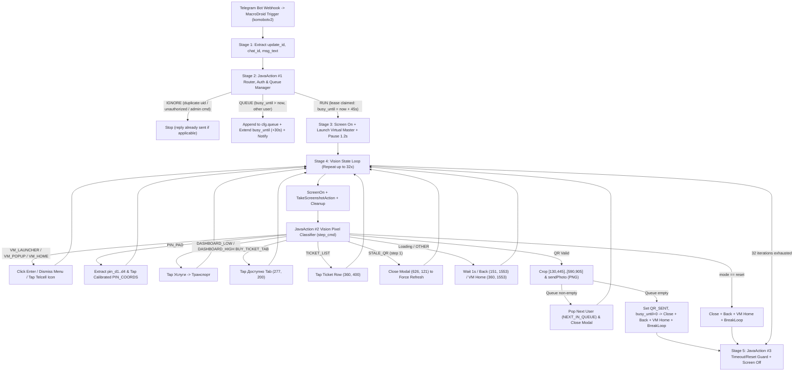

# Komobot — Standalone Android QR Automation Controller

Komobot is a serverless, on-device Android automation pipeline that turns a physical `720x1600` Android phone into a self-contained Telegram QR code responder for **Telcell Wallet** (`ru.deltapay.puntopago.telcell`) running inside **Virtual Master** (`com.clone.android.dual.space`).

Once deployed via ADB, there is **no PC, Docker container, or external backend server** required at runtime: Telegram sends updates directly to a MacroDroid cloud webhook trigger on the phone, and all routing, access control, queueing, host-level screen capture, pixel-based UI navigation, QR cropping, and Telegram photo uploads execute locally inside **MacroDroid**.

---

## Key Capabilities & Architectural Design

* **Standalone On-Device Execution:** Generated via [`generate_macro.py`](generate_macro.py) (`210` MacroDroid actions, `3` BeanShell `JavaAction` scripts) and deployed over ADB with [`deploy_macro.sh`](deploy_macro.sh). All runtime state lives in `/storage/emulated/0/Download/komobot_config.json`.
* **`FLAG_SECURE` Bypass Without Root:** Financial apps block `adb screencap` and native screenshots when run directly on the host OS. Running the target app inside **Virtual Master** renders the guest OS inside a Virtual Master host surface, letting MacroDroid's host-level `TakeScreenshotAction` capture every screen—including the PIN pad and QR modal—without root.
* **Serverless Telegram Webhook Trigger:** Telegram Bot API updates arrive via a MacroDroid `WebHookTrigger` (`identifier: "komobotv2"`, body stored in `{lv=webhook_body}`).
* **Multi-User Access Control & In-Loop FIFO Queueing:** Authorized users share access through `/storage/emulated/0/Download/komobot_config.json`. Concurrent requests are serialized by a time-bounded `busy_until` lease and an in-memory/disk FIFO `queue` so burst requests from multiple users execute back-to-back in a single phone wake cycle.
* **Stale Ticket & Stale QR Protection:** Navigates through the dashboard **`Услуги` → `Транспорт` → `Доступно`** ticket list rather than quick shortcuts (which can open an expired/stale ticket). Automatically switches tabs if `Купить билет` opens instead of `Доступно`, and rejects/refreshes a QR modal if one was already open on `step_count == 1`.
* **Deep Doze & Extended Inactivity Resilience:** [`deploy_macro.sh`](deploy_macro.sh) disables Android Doze (`dumpsys deviceidle disable`), app standby, Android Phantom Process Killer monitoring (`settings_enable_monitor_phantom_procs false` and `max_phantom_processes 2147483647` for Virtual Master's guest processes), Wi-Fi power saving/sleep, host lockscreen, Virtual Master toast windows, and Samsung Smart Capture toolbars. Extended cold-boot tolerances (`32×` loop, `WHITE_LOADING` `<= 5`, `DASH_LOADING < 3`) let Virtual Master and Telcell Wallet recover even after LMKD evictions, while keeping Virtual Master in the host foreground on sleep (`ScreenOnAction(screen_off=True)`). *(Re-run `./deploy_macro.sh` after a full phone reboot, as `dumpsys deviceidle disable` is non-persistent.)*

---

## Full Pipeline Architecture

The generated macro (**Komobot Controller**, `210` actions) processes every incoming Telegram update through five sequential stages:



### Stage 1: Webhook Ingestion & Field Extraction

Triggered by MacroDroid's `WebHookTrigger` (`identifier: "komobotv2"`), three `TextManipulationAction` (`ExtractTextManipulation`) steps extract values from `{lv=webhook_body}` with safe default suffixes so missing JSON fields never abort the macro:

| Local Variable | Regex Pattern | Fallback Source Suffix |
| :--- | :--- | :--- |
| `update_id` | `"update_id":\s*(\d+)` | `"update_id":0` |
| `chat_id` | `"chat":\s*\{\s*"id":\s*(-?\d+)` | `"chat":{"id":0` |
| `msg_text` | `"text":\s*"([^"]{0,200})"` | `"text":""` |

### Stage 2: Router, Auth, Command Handler & Queue Manager (`JavaAction #1`)

`build_router_script()` runs synchronously under `synchronized (System.class)` to keep `komobot_config.json` consistent across concurrent webhook invocations:

1. **Deduplication & Diagnostics:** Drops any non-zero `uid <= last_update_id` (`return "IGNORE"`). Updates with `update_id: 0` bypass deduplication and never advance `last_update_id`, making synthetic diagnostics safe. Every non-duplicate update records `last_chat_id` and `last_msg_text` in `komobot_config.json`.
2. **Authorization:** Compares `chat_id` against `admin_id` (seeded from `{lv=admin_id}`) and `allowed_users`. Unauthorized users receive `⛔ Unauthorized. Your ID: <cid>`.
3. **Access & Admin Commands:** Handles `/start` (role-specific Reply Keyboard), `/adduser <id>`, `/removeuser <id>`, `/listusers` / `👥 List Users`, and `/toggle` / `🛑 Toggle Public Access`. When `public_access` is `false`, non-admin allowed users receive `⚠️ The bot is currently locked by the admin.`.
4. **Concurrency Lock & Queue Insertion:**
   * If `now < busy_until`:
     * Same `active_chat_id` (after `>= 3s`): replies `⏳ Your request is already in progress.` without enqueueing a duplicate.
     * Another allowed user not yet in `queue`: appends `{"chat_id": cid, "status_message_id": 0}`, extends `busy_until` by `+30000ms`, sends a queued status message (detailed waiting notice for Admin; `0%` progress bar for regular users), and patches the saved `status_message_id` into the matching queue entry.
     * Another user already in `queue`: replies `⏳ You are already in the queue (#N).`.
   * If idle (`now >= busy_until`): initializes a new run (`busy_until = now + 45000`, `active_chat_id = cid`, `capture_mode = "qr"` or `"reset"`, `queue = []`, `qr_was_closed = false`, `step_count = 0`, `other_count = 0`, `progress_pct = 0` or `10`, `last_state = "INIT"`, `run_start_ms = now`), sends `🔍 Waking phone & checking Virtual Master...` for Admin or an initial `10%` progress bar (`🟩⬜⬜⬜⬜⬜⬜⬜⬜⬜ 10%`) for regular users, stores `status_message_id`, and returns `bot_action = "RUN"`.

### Stage 3: Screen Wake & Virtual Master Foregrounding

When `{lv=bot_action}` equals `"RUN"`:
1. `ScreenOnAction(screen_off=False)` wakes the display (lockscreen is disabled at provisioning time by `deploy_macro.sh`).
2. `LaunchActivityAction` brings **Virtual Master** (`com.clone.android.dual.space`) to the foreground.
3. `PauseAction` waits `1.2s` for the surface to settle.

### Stage 4: Vision-Guided State Machine Loop (`Repeat 32×`, `JavaAction #2`)

Each iteration wakes/keeps the screen on (`ScreenOnAction`), captures a host screenshot (`TakeScreenshotAction`), and runs `build_vision_script()` (`response_var="step_cmd"`):

1. **Fresh Screenshot Polling & Cleanup:**
   * Polls `/storage/emulated/0/DCIM/Screenshots` and `/storage/emulated/0/Pictures/Screenshots` for up to `3.8s` (at `150ms` intervals) for a `Screenshot*` file `> 5KB` with `lastModified >= run_start_ms - 2500` newer than `(last_ss_name, last_ss_mtime)`.
   * Decodes via `BitmapFactory.decodeFile` (up to `5` attempts) and normalizes `(x, y)` coordinates from the `720x1600` reference layout (`px(x) = x * w / 720`, `py(y) = y * h / 1600`).
   * In its `finally` block, recycles the `Bitmap` and calls `cleanScreenshots()` (waits up to `1s` after capture so Samsung/MediaStore finishes writing thumbnails, then deletes the temporary screenshot, `thumbnail_<latest>`, and any `.trashed-*Virtual Master*` / `thumbnail_*Virtual*` artifacts).

2. **State Classification & UI Dispatch Branches:**

| Detected Screen (`last_state`) | Visual Heuristic (`720x1600`) | Dispatched `step_cmd` & MacroDroid Actions |
| :--- | :--- | :--- |
| `NO_SCREENSHOT` / `DECODE_ERR` | No new screenshot within `3.8s` or unreadable file | `WAIT` -> Pause `1s` |
| `VM_LAUNCHER` | Dark VM card with bright `Enter` button `(595..670, 235..265)` | `CLICK_ENTER` -> Click text `"Enter"` + Click `(627, 250)` + Pause `2s` |
| `VM_LOADING` | Dark VM boot background without `Enter` button | `WAIT` -> Pause `1s` |
| `VM_POPUP` | Dark 3×3 Virtual Master quick-menu corners `(130/590, 590/1050)` | `DISMISS_POPUP` -> Click `(100, 200)` + Pause `500ms` |
| `RESET` (`capture_mode == "reset"`) | Any screen while running admin Reset command | `DONE_RESET` -> Close `(626, 121)` + `300ms` + VM Back `(151, 1553)` + `300ms` + VM Home `(360, 1553)` + `BreakFromLoopAction` |
| `STALE_QR` | QR modal present on `step_count == 1` with `qr_was_closed == false` | `CLOSE_MODAL` -> Click `(626, 121)` + Pause `800ms` (forces fresh ticket open) |
| QR Valid -> `NEXT_IN_QUEUE` / `QR_SENT` | Darkened backdrop, white modal card, `>= 100` dark & `>= 100` light QR modules in `(200..520, 510..830)` | Crops `[130, 445]..[590, 905]` (`460x460`), encodes lossless PNG, uploads via `multipart/form-data` `sendPhoto` (`🎫 QR Code`), deletes progress message on HTTP `200`. Dispatches `CLOSE_MODAL` if `queue` has another user, else `DONE`. |
| `QR_LOADING` | White modal card without QR modules yet | Bounded `WAIT` via `loading_count` (`<= 6` -> `WAIT`; `7` -> `CLICK_BACK`; `>= 9` -> `RESET_TO_HOME`) |
| `VM_HOME_1` / `VM_HOME_2` | Dark VM wallpaper with orange Telcell icon at row `(80..120, 360..400)` or `(80..120, 120..165)` | `LAUNCH_1` `(97, 382)` or `LAUNCH_2` `(97, 142)` + Pause `2.5s` |
| `PIN_SPINNER` | Gray PIN background with orange Telcell logo and spinner at `(330..390, 680..715)` | Bounded `WAIT` via `loading_count` (`<= 6` -> `WAIT`; `7` -> `CLICK_BACK`; `>= 9` -> `RESET_TO_HOME`) |
| `PIN_PAD` | Gray PIN screen `(100, 500)` & `(360, 1372)` + `>= 10` Telcell orange logo pixels `(280..440, 120..220)` | `ENTER_PIN` -> 4× `ExtractTextManipulation` split `app_pin` into `pin_d1..pin_d4`; `IfConditionAction` branches tap calibrated `PIN_COORDS` (`450ms` inter-digit pause, `2.5s` post-PIN pause) |
| `DASH_LOADING` | Dashboard nav visible while white skeleton covers content or `svcLow < 3 && svcHigh < 3` (`loading_count < 3`) | Bounded `WAIT` via `loading_count` (`<= 6` -> `WAIT`; `7` -> `CLICK_BACK`; `>= 9` -> `RESET_TO_HOME`) |
| `DASHBOARD_LOW` / `DASHBOARD_HIGH` | Dashboard bottom nav bar orange/white; scans `Услуги` orange icon offsets (`1045..1105` vs `785..845`) | `CLICK_TRANSPORT_LOW` `(360, 1100)` or `CLICK_TRANSPORT_HIGH` `(360, 840)` + Pause `1.5s` |
| `BUY_TICKET_TAB` | `Проездной билет` opened on `Купить билет` tab (orange underline at `x=100, y=235` or buy card button `(550, 485)`) | `CLICK_AVAILABLE_TAB` -> Click `Доступно` `(277, 200)` + Pause `1.5s` |
| `TICKET_LOADING` | `Доступно` tab active on gray list background, ticket card still loading | Bounded `WAIT` via `loading_count` (`<= 6` -> `WAIT`; `7` -> `CLICK_BACK`; `>= 9` -> `RESET_TO_HOME`) |
| `TICKET_LIST` | `Проездной билет -> Доступно` (`buyBtnOrange` or `availTabOrange`) with bright white ticket card at `(360, 400)` | `CLICK_TICKET_ROW` -> Click `(360, 400)` + Pause `1.2s` |
| `WHITE_LOADING` | White/blank transition screen (`>= 34/40` white grid samples in `x=120..600, y=240..1290`, avoiding dense multi-column UI) | Bounded `WAIT` via `white_count` (`<= 5` -> `WAIT`; `6` -> `CLICK_BACK` `(151, 1553)`; `7` -> `WAIT`; `>= 8` -> `RESET_TO_HOME` `(360, 1553)`) |
| `OTHER` | Unrecognized transition/overlay screen (`other_count`) | `1` or `3` -> `WAIT` (`1s`); `2` -> `CLICK_BACK` `(151, 1553)` + `800ms`; `>= 4` -> `RESET_TO_HOME` `(360, 1553)` + `800ms` (resets `other_count = 0`) |

3. **Clean Exit vs. Queue Handoff & Role-Specific Status UI:**
   * **Admin (`cid == admin_id`):** Receives full internal step-by-step status logs (`🖥️ Entering Virtual Master...`, `🚀 Launching Telcell Wallet...`, `🔐 Entering PIN...`, etc.) and diagnostic timeout details (`last state: ...`).
   * **Regular Users (`cid != admin_id`):** Internal step logs are replaced by a monotonic emoji progress bar (`0% -> 10% -> ... -> 90%`) that never regresses backwards and omits internal app/VM details, including on timeouts (`❌ Timed out generating QR code. Please try again.`).
   * **Queue Non-Empty (`NEXT_IN_QUEUE`):** Pops `queue[0]`, sets `active_chat_id` and `status_message_id` to the queued user, sets `step_count = 2`, `qr_was_closed = true`, `busy_until = now + 45000`, edits their message to `🔄 Generating QR code for your request...` (Admin) or `70%` progress bar (regular user), and returns `CLOSE_MODAL` (`(626, 121)`) so the next iteration immediately lands back on `TICKET_LIST` and opens a fresh QR for the next user.
   * **Queue Empty (`DONE`):** Sets `last_state = "QR_SENT"`, `busy_until = 0`, clicks Close `(626, 121)` -> `500ms` -> VM Back `(151, 1553)` -> `500ms` -> VM Home `(360, 1553)` -> `BreakFromLoopAction`. Exiting back to the VM desktop guarantees the next request starts from a clean state without stale QR modals or open `Купить билет` tabs.

### Stage 5: Post-Loop Guard (`JavaAction #3`) & Screen Sleep

After exiting the `32×` loop, `build_timeout_script()` checks whether `busy_until > 0` or `step_cmd == "DONE_RESET"`:
* Resets `busy_until = 0` and `queue = []`.
* Edits the active (and any remaining queued) status messages with `✅ VM app reset complete.` or `❌ Timed out waiting for QR screen (last state: <last_state>). Please try again.` (Admin) / `❌ Timed out generating QR code. Please try again.` (regular user).
* Finally executes `ScreenOnAction(screen_off=True)` to put the display to sleep (`mWakefulness=Dozing`) with Virtual Master still in the host foreground.

---

## Project Structure

```text
komobot/
├── generate_macro.py   # MacroDroid JSON compiler + embedded BeanShell router, vision & guard scripts
├── deploy_macro.sh     # ADB provisioning, Doze/power/lockscreen tuning & automated MacroDroid import
├── tests/              # Offline BeanShell scenario suite + live device webhook runner
│   ├── bsh_runtime.py
│   ├── test_macro_structure.py
│   ├── test_router_and_timeout_scenarios.py
│   ├── test_vision_scenarios.py
│   └── run_device_scenarios.py
├── pyproject.toml      # Project metadata & dev tooling (ruff, shfmt-py)
├── ruff.toml           # Ruff formatting/linting configuration
├── .python-version     # Python version pin (3.10)
├── .gitignore          # Ignores .env, gomorrah/, *.pyc, *.macro
└── .env                # Local secrets & device app config (not committed)
```

Generated artifacts:
* `Komobot_Controller.macro` (ignored by git via `*.macro`): Created by `generate_macro.py` with local variables (`bot_token`, `admin_id`, `app_pin`, `app_name`) populated during deployment and removed from `/storage/emulated/0/Download/` after import.

---

## Setup & Deployment

### Prerequisites

1. **Target Android Phone (`720x1600`, tested on Samsung Galaxy A06 `SM-A065F`):**
   * **USB Debugging** enabled and authorized via `adb devices`.
   * **MacroDroid** (`com.arlosoft.macrodroid`) installed with Accessibility / UI Interaction enabled, plus **MacroDroid Helper** (optional/recommended) and cloud Webhook Trigger active (`https://trigger.macrodroid.com/<device_uuid>/komobotv2`).
   * **Virtual Master** (`com.clone.android.dual.space`) installed with the guest VM configured (`720x1600`) and **Telcell Wallet** (`ru.deltapay.puntopago.telcell`) installed and **already logged in** inside the VM.
     > **Important:** Keep the target app logged in inside Virtual Master—never log out of the Telcell Wallet account during maintenance or testing.
2. **Host Machine (for deployment):** Python `>= 3.10` and `adb` (`android-sdk-platform-tools`).

### 1. Configure `.env`

Create `.env` in the repository root:

```dotenv
BOT_TOKEN="<your_telegram_bot_token>"
ADMIN_ID="<your_numeric_telegram_user_id>"
APP_PIN="<4_digit_telcell_pin>"
APP_NAME="ru.deltapay.puntopago.telcell"
```

### 2. Deploy to the Phone

Connect the phone over USB and run:

```bash
./deploy_macro.sh
```

`deploy_macro.sh` will:
1. Read defaults from `.env` (or prompt interactively if unset).
2. Generate `Komobot_Controller.macro` via `generate_macro.py`.
3. Grant `WRITE_SECURE_SETTINGS`, `WRITE_GLOBAL_SETTINGS`, `READ_LOGS`, `DUMP`, `MANAGE_EXTERNAL_STORAGE`, and `SYSTEM_ALERT_WINDOW` to MacroDroid.
4. Whitelist `com.arlosoft.macrodroid` and `com.clone.android.dual.space` in `deviceidle`, grant `RUN_IN_BACKGROUND`, `RUN_ANY_IN_BACKGROUND`, and `WAKE_LOCK`, disable Doze, app standby, Phantom Process Killer monitoring (`settings_enable_monitor_phantom_procs` / `max_phantom_processes`), Wi-Fi sleep, lockscreen, and Samsung Smart Capture, and deny Virtual Master `TOAST_WINDOW` overlays.
5. Seed `/storage/emulated/0/Download/komobot_config.json` if absent (preserving existing device config across upgrades).
6. Push `Komobot_Controller.macro`, wake the screen, launch MacroDroid's importer, tap `acceptButton`, and confirm `OVERWRITE` via `uiautomator` node lookup (with coordinate fallbacks).

### 3. Register the Telegram Webhook

Point your Telegram bot's webhook to your phone's MacroDroid Webhook Trigger URL (displayed inside MacroDroid's Webhook trigger configuration):

```bash
curl -sS -X POST "https://api.telegram.org/bot${BOT_TOKEN}/setWebhook" \
  -d "url=https://trigger.macrodroid.com/<device_uuid>/komobotv2"
```

Verify with `getWebhookInfo` that `pending_update_count` is `0` and `last_error_message` is empty.

---

## Telegram Commands & Reply Keyboard

| Command / Button | Access | Behavior |
| :--- | :--- | :--- |
| `/start` | Allowed users & Admin | Sends custom Reply Keyboard (`📸 Take QR Screenshot` for users; also `👥 List Users`, `🛑 Toggle Public Access`, `🧹 Reset VM App` for Admin). |
| `/qr`, `qr`, `📸 Take QR Screenshot` | Allowed users (`public_access` enabled) & Admin | Triggers the full wake -> Virtual Master -> Telcell PIN -> `Услуги -> Транспорт -> Доступно` -> QR crop/upload pipeline (case-insensitive; also matches messages containing `qr` or `screenshot`). |
| `/listusers` or `👥 List Users` | Admin only | Lists all Telegram IDs in `allowed_users`. |
| `/adduser <id>` | Admin only | Adds `<id>` to `allowed_users`. |
| `/removeuser <id>` | Admin only | Removes `<id>` from `allowed_users`. |
| `/toggle` or `🛑 Toggle Public Access` | Admin only | Toggles `public_access` (`true`/`false`) for non-admin allowed users. |
| `🧹 Reset VM App` | Admin only | Enters `reset` mode (`DONE_RESET`): closes any open modal, taps VM Back & VM Home, clears `busy_until`, and sleeps the screen. |

---

## Runtime State & Diagnostics (`/storage/emulated/0/Download/komobot_config.json`)

| Field | Purpose |
| :--- | :--- |
| `admin_id`, `allowed_users`, `public_access` | Access-control policy managed at runtime via Telegram admin commands. |
| `last_update_id` | Highest non-zero Telegram `update_id` processed (used to ignore duplicate retries). |
| `last_chat_id`, `last_msg_text` | Most recent non-duplicate sender ID and extracted message text for debugging webhook parsing. |
| `busy_until`, `queue` | Concurrency lock epoch (`ms`) and FIFO array of waiting `{"chat_id", "status_message_id"}` entries. |
| `active_chat_id`, `status_message_id`, `capture_mode`, `run_start_ms` | Active run ownership, progress message ID for `editMessageText`, mode (`"qr"`/`"reset"`), and run start timestamp. |
| `qr_was_closed`, `step_count`, `other_count`, `white_count`, `loading_count`, `last_state` | State-machine progress flags, total vision iterations (`1..32`), recovery counters, and last classified screen state (e.g., `QR_SENT`, `STALE_QR`, `BUY_TICKET_TAB`, `TICKET_LIST`, `WHITE_LOADING`). |
| `last_ss_name`, `last_ss_mtime`, `app_name` | Last processed host screenshot identity (prevents re-reading stale screenshots) and configured package name. |

### Safe Synthetic Webhook Testing

When testing the MacroDroid webhook directly with `curl`, **always pass `"update_id": 0`** so `last_update_id` on the phone is never pushed ahead of Telegram's real update counter:

```bash
curl -4 -sS -X POST "https://trigger.macrodroid.com/<device_uuid>/komobotv2" \
  -H "Content-Type: application/json" \
  -d "{\"update_id\":0,\"message\":{\"message_id\":9999,\"chat\":{\"id\":${ADMIN_ID}},\"text\":\"\\ud83d\\udcf8 Take QR Screenshot\"}}"
```

---

## Test Scripts & Scenarios

### Offline Scenario & Structure Tests (No Phone Required)

Executes macro schema/regex/PIN checks and compiles/runs the generated BeanShell `router`, `vision`, and `timeout` scripts against an in-memory Android/Bitmap/Telegram sandbox:

```bash
python3 -m unittest discover -s tests -v
```

* [`tests/test_macro_structure.py`](tests/test_macro_structure.py): Macro schema, unique `m_SIGUID`s, balanced `If`/`Loop` actions, `step_cmd` branch coverage, `PIN_COORDS` mapping, centered nav taps, Stage 1 regex extraction, and BeanShell compilation.
* [`tests/test_router_and_timeout_scenarios.py`](tests/test_router_and_timeout_scenarios.py): Deduplication (`update_id: 0` safety vs repeated `uid`), auth, `/start` keyboards, `/adduser`/`/removeuser`/`/toggle`, busy lease & expired lease reclaim after extended inactivity, multi-user FIFO queue, and post-loop timeout/`DONE_RESET` cleanup.
* [`tests/test_vision_scenarios.py`](tests/test_vision_scenarios.py): Synthetic `720x1600` & `1080x2400` screen pipelines (`VM_LAUNCHER` -> `PIN_PAD` -> `DASHBOARD` -> `BUY_TICKET_TAB` -> `TICKET_LIST` -> `QR_SENT`), full 30-step cold VM + cold Telcell resume within `32` steps, `STALE_QR` refresh, queue handoff (`NEXT_IN_QUEUE`), `WHITE_LOADING` (`<= 5`) vs dense UI / `PIN_PAD` regressions, `3`-tick unloaded dashboard wait, bounded loading recovery, and screenshot cleanup.

### Live Device E2E Scenario Runner (ADB + Webhook)

Runs non-destructive live scenarios against the USB-connected phone (uses `"update_id": 0` except `dedup`, never logs out of Telcell Wallet, and resolves the webhook URL via `getWebhookInfo`):

```bash
# List scenarios or verify ADB + config + webhook without sending updates
python3 tests/run_device_scenarios.py --list
python3 tests/run_device_scenarios.py --dry-run

# Run default audit + non-busy suite, long-inactivity audit/unplugged wakeup, or all scenarios
python3 tests/run_device_scenarios.py
python3 tests/run_device_scenarios.py --scenario inactivity_audit unplugged_doze_qr --idle-wait 10
python3 tests/run_device_scenarios.py --scenario all
```

---

## Development Linting & Formatting

```bash
# Lint & format macro generator and tests (requires .venv)
.venv/bin/ruff format generate_macro.py tests
.venv/bin/ruff check generate_macro.py tests

# Format deployment script
.venv/bin/shfmt -w deploy_macro.sh
```
